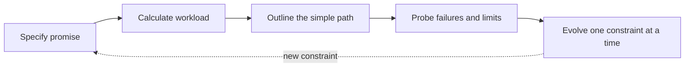

# SCOPE: a constraint-first design method

> SCOPE turns a vague system prompt into a small design you can explain, test, and evolve.

Many design discussions jump from a product name straight to caches, queues, and databases. SCOPE reverses that order. First make the user promise and workload explicit; then draw only the path needed to meet them.

## The five moves

| Move | Ask | Leave with |
|---|---|---|
| **S — Specify** | Who needs what outcome? Which invariant must never be broken? | A short scope, success measure, and correctness rule. |
| **C — Calculate** | What is the expected and peak workload? How much data moves or accumulates? | A few round-number estimates that affect the design. |
| **O — Outline** | What is the simplest end-to-end read and write path? | A small diagram and the data each step owns. |
| **P — Probe** | What happens under timeout, retry, overload, stale data, or node loss? | Failure behavior, recovery steps, and the first bottleneck. |
| **E — Evolve** | Which measured limit justifies the next component or partition? | One deliberate change with its benefit and cost. |

## How to use it in a design round

### Specify

Write one sentence describing the user outcome. Then name the invariant that matters most. For a payment, for example, a charge must not be applied twice. For a notification, accepting a request and delivering it are different events; say which one the service promises.

Ask only questions whose answers could change the design. If the answer will not change a box, an API, a guarantee, or a number, defer it.

### Calculate

Use round numbers and expose the assumptions. Estimate average and peak requests, the read/write mix, retained data, and payload size. State the consequence: “This peak fits on one partition today, so I will keep the first version simple and identify the metric that would make me split it.”

An estimate is useful when it changes a decision. Precision without a design consequence is arithmetic theater.

### Outline

Draw one successful write and one successful read. Label the persistent source of truth and show where asynchronous work begins. Keep the first sketch small. A component earns a place when it owns a responsibility or removes a constraint already stated.

### Probe

Pick the failure most likely to violate the user promise. Trace it step by step: what is retried, what is deduplicated, what becomes visible, and how does the system recover? Then probe overload and partial dependency failure. Prefer a concrete degraded behavior over “the system is highly available.”

### Evolve

Change one thing at a time. Add a cache for a demonstrated read bottleneck, partition for a measured capacity limit, or queue when work can safely become asynchronous. Name what the change makes harder: invalidation, rebalancing, lag, or operational burden.

## The SCOPE review

Before you finish, answer these five questions:

1. What user-visible promise does the design make?
2. Which estimate most influenced the architecture?
3. Can you trace one request through the system without skipping a hop?
4. What is the first failure that changes what a user sees?
5. What evidence would make you evolve the design, and what new cost would follow?

If an answer is missing, return to that move instead of adding more boxes.

## Practice

Try the [notification delivery example](scope-notifications-worked-example.md) once with the explanation hidden, then compare your design. Next, use SCOPE on a [rate limiter](../questions/design-rate-limiter.md) and a [payment system](../questions/design-payment-system.md). Keep a short decision log: assumption, evidence, choice, cost.

SCOPE is a learning aid created for Systems Workbench. It is not a formal industry standard, and the order is a guide rather than a script; a real conversation may revisit earlier moves when requirements change.
