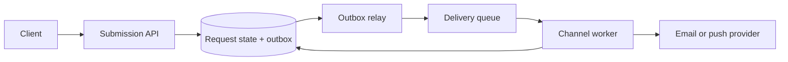

# SCOPE example: notification delivery

> A worked example of turning delivery guarantees and workload into a notification service design.

Use this example to see how the [SCOPE method](scope-method.md) changes the design one constraint at a time. The numbers are assumptions for practice, not claims about a real product.

## S — Specify

Users or product services submit a notification request. The system validates it, schedules delivery, and records its progress.

For this exercise, assume:

- The API promises that an accepted request is durably queued.
- Delivery may be delayed or fail; the API does not promise that a person has read the message.
- A request ID is stable across client retries, so repeated submissions should not create additional logical jobs.
- Email and push are in scope. User preference management and message authoring are out of scope.

The key distinction is **accepted** versus **delivered**. Conflating these states would make a successful API response claim more than the service knows.

## C — Calculate

Assume one million accepted notifications per day, with a peak ten times the daily average:

- Average arrival rate: 1,000,000 / 86,400 ≈ **12 requests/second**.
- Assumed peak: 12 × 10 ≈ **120 requests/second**.
- At 1 KB of metadata per request, 30 days of raw metadata is about **30 GB**, before indexes, replicas, and retention overhead.

These estimates do not justify a complex distributed database or dozens of partitions. They do justify measuring queue age and provider latency, because bursts and a slow provider can create a backlog even when the average rate is modest.

## O — Outline

1. The API validates the request and writes its stable request ID and an outbox event in one database transaction.
2. A relay publishes outbox events to the delivery queue. It may publish an event more than once if it crashes after publishing but before recording progress.
3. A worker claims a job, checks its state, and calls the selected provider with a provider idempotency key when supported.
4. The worker records accepted, delivered, retrying, or terminal-failure state. A delivery receipt can arrive later than the provider call.

The database is the source of truth for request state. The queue is a delivery mechanism; losing or duplicating a queue message must not silently lose the durable request.

## P — Probe

| Failure | User-visible risk | Response |
|---|---|---|
| Client retries after an API timeout | Duplicate logical requests | Unique constraint on request ID; return the existing request state. |
| Relay publishes and crashes before acknowledging | Duplicate queue event | Make worker processing idempotent; record transitions conditionally. |
| Provider times out after accepting a send | Retrying may send twice | Reuse a provider idempotency key where available; otherwise treat the result as ambiguous and make the duplicate risk explicit. |
| Provider slows down | Queue age grows; fresh alerts arrive late | Bound concurrency per provider, apply backoff, and route unhealthy-provider work to a delayed retry path. |
| Poison request repeatedly fails | One job consumes worker capacity | Limit retries, record the terminal reason, and move it to a reviewable dead-letter state. |

“Exactly once” is not a property we can claim across our database, queue, and an external provider without a shared transaction or provider guarantee. The design instead uses durable intent, idempotent transitions, and explicit handling of ambiguous outcomes.

## E — Evolve

Start with a relational database, an outbox relay, a managed queue, and workers. Add complexity only when an observed limit calls for it:

- If queue age rises while workers are saturated, increase worker capacity and check provider quotas before splitting the queue.
- If one provider’s latency harms another channel, use separate concurrency pools and queues for isolation.
- If a single queue partition is demonstrably the throughput limit, partition by a stable key and define how ordering works for that key.
- If request history grows beyond the retention target, archive completed records or expire them according to the product's recovery and audit needs.

Each evolution adds operational work. More partitions require rebalancing; more queues require monitoring and routing rules; shorter retention reduces storage but can limit investigations. The next design step should follow the measured constraint.

## Try it yourself

Change one assumption and redo the relevant SCOPE move:

- A notification must arrive within 30 seconds, even during a provider outage. What can the service honestly promise?
- A single customer creates half the traffic. What isolation or fairness rule is needed?
- Users can cancel a queued notification. Which state transitions must become conditional?

Write down the changed assumption, the design change it forces, and the new cost. Then compare your result with the [notification system question](../questions/design-notification-system.md).
