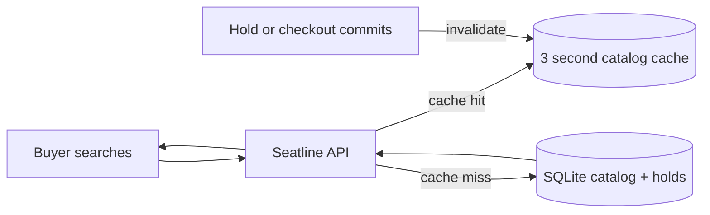
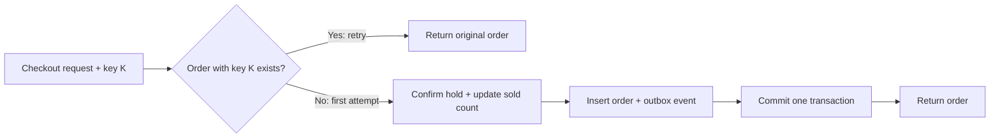
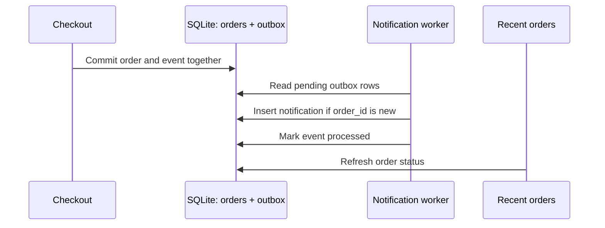
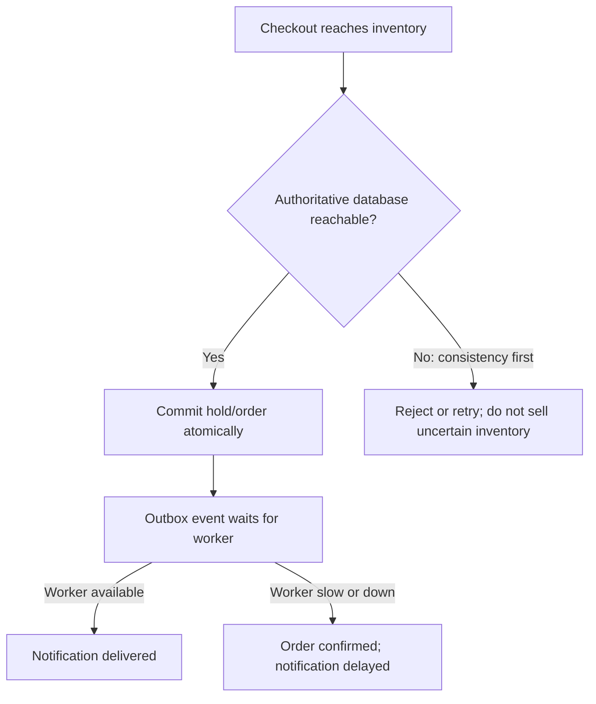

# Seatline: follow a ticket reservation end to end

Use one ticket purchase to connect system design ideas to working code. Keep the [live Seatline demo](https://study.192-168-1-22.sslip.io/seatline/) open as you read. The walkthrough follows a buyer from browsing an event to receiving an order confirmation, then pauses at the points where concurrency, retries, and dependency failures change the design.

> **What the system promises:** a confirmed ticket belongs to one buyer, even when two buyers race for the last seat or a checkout response is lost.

This is a teaching baseline: one Python process, SQLite, a short in-process catalog cache, and a background notification worker. Payment is simulated. It does not claim multi-region availability or independent failure isolation between these pieces.

## 1. Browse: make reads cheap, keep the promise clear

Open Seatline and search the event list. A short-lived cache helps repeated catalog reads. After a hold or checkout changes inventory, the app invalidates that cache so the next list reflects the write.



- **In the code:** [`list_events` and `invalidate_events` in `app.py`](https://github.com/piyooshsinha/grokking-system-design/blob/main/examples/seatline/app.py#L96-L127).
- **Try it:** search the catalog, reserve seats, then check the remaining count. The UI refreshes the list after a successful write.
- **Study:** [Caching](../patterns/caching.md) and [database query shape](../fundamentals/databases.md).

The cache is process-local, so it is simple and fast but cannot be shared across multiple app instances. A Redis cache would need explicit invalidation or versioning and a decision about how much stale inventory a browse page may show. Reservation correctness must still come from the database transaction, never from the cached count.

## 2. Reserve: protect the last seat

Choose a nearly sold-out event and reserve a seat. Then run **Race for the last seat**: the lab creates a disposable one-seat event and launches two holds together. One succeeds; the other receives `409`, and the temporary event is removed.

```mermaid
sequenceDiagram
    participant A as Buyer A
    participant API as Seatline API
    participant DB as SQLite
    participant B as Buyer B
    par Concurrent request A
      A->>API: Hold one seat
      API->>DB: BEGIN IMMEDIATE; read capacity; insert hold
      DB-->>A: Hold created
    and Concurrent request B
      B->>API: Hold one seat
      API->>DB: Wait, then read committed capacity
      DB-->>B: 409; no seat remains
    end
```

- **In the code:** [`create_hold`](https://github.com/piyooshsinha/grokking-system-design/blob/main/examples/seatline/app.py#L144-L173) serializes the capacity check with `BEGIN IMMEDIATE`; [`run_race_lab`](https://github.com/piyooshsinha/grokking-system-design/blob/main/examples/seatline/app.py#L221-L263) runs and cleans up the two-request exercise.
- **Invariant to check:** `sold + active, unexpired holds <= capacity`.
- **Study:** [Database transactions](../fundamentals/databases.md), [idempotency](../patterns/idempotency.md), and [distributed locking](../patterns/distributed-locking.md).

SQLite is the single authority in this version. If the design moves to PostgreSQL, compare row locks and conditional updates under the same race. If inventory is split across regions, a local count is no longer enough: the system needs a deliberate ownership, reservation, or coordination strategy.

## 3. Checkout: make a retry safe

Confirm a reservation. Seatline sends the checkout twice with the **same idempotency key**, as if the first response was lost in transit. Both responses should identify the same order.



- **In the code:** [`checkout`](https://github.com/piyooshsinha/grokking-system-design/blob/main/examples/seatline/app.py#L176-L207) checks the request key first, updates the hold and sold count, writes the order and outbox row, and commits them together.
- **Try it:** compare the two checkout rows in **Request trace** and the result in **Retry after a lost response**.
- **Study:** [Idempotency](../patterns/idempotency.md) and [distributed transactions](../patterns/distributed-transactions.md).

The key makes repeating this operation safe. It does not make every later operation exactly-once: downstream delivery can repeat, so the notification consumer also needs deduplication.

## 4. Notify: separate order confirmation from delivery

The order and its notification event are committed in the same database transaction. A worker polls the outbox and creates the notification. Use **Replay delivery** in Recent orders to enqueue the same logical event again; the unique `order_id` prevents a duplicate notification.



- **In the code:** [`checkout`](https://github.com/piyooshsinha/grokking-system-design/blob/main/examples/seatline/app.py#L176-L207), [`outbox_worker`](https://github.com/piyooshsinha/grokking-system-design/blob/main/examples/seatline/app.py#L265-L285), and [`replay_notification`](https://github.com/piyooshsinha/grokking-system-design/blob/main/examples/seatline/app.py#L209-L219).
- **Try it:** replay a delivery and watch the request trace and order status. A repeated event should not create a second notification.
- **Study:** [Transactional outbox](../patterns/outbox-pattern.md), [message queues](../patterns/message-queues.md), and [backpressure](../patterns/backpressure.md).

### Failure exploration: the worker is slow or unavailable

Suppose notification delivery falls behind. The order can still be confirmed because the outbox row is durable and committed with it; the confirmation appears later when a worker processes the backlog. If the worker stops, pending rows wait in the database. The next design should expose queue age and backlog, retry with limits, and define what happens to poison events. It should also run the relay independently so a worker failure does not take the checkout HTTP process down.

Seatline's worker is a thread inside the same Python process. The live app does not offer a switch to stop just that thread, so treat this as an architecture exercise rather than a failure toggle in the demo. The outbox itself is real and the duplicate-delivery behavior is runnable.

## 5. Probe slow and unavailable dependencies

Use these prompts to reason about behavior beyond the baseline. For each, decide what the buyer sees, which invariant must remain true, and what signal would reveal the problem.

| Scenario | What this version does | Design decision to explore |
|---|---|---|
| Catalog read is slow | A cache hit avoids SQLite for a short period; a miss reads the database. | Set a read timeout, serve explicitly stale browse results if acceptable, and keep checkout's capacity check authoritative. |
| SQLite is locked or slow | SQLite waits up to its configured busy timeout; prolonged lock contention can surface as an operational error. | Bound request time, return a clear retryable response, shed excess load, and use the same idempotency key for a checkout retry. |
| Database is unavailable | Holds and checkout cannot safely establish inventory or order state. This app does not have a tested database-failure mode. | Fail closed for reservation writes; do not claim a ticket was sold. Decide whether browse can use stale cached data and label its freshness. |
| Notification worker is unavailable | A committed outbox row remains pending while the process and database remain available. | Keep checkout independent of notification latency; alert on oldest pending event and backlog size; restart or scale the relay. |
| Network partition between inventory regions | This baseline has one SQLite database and no replica to fail over to. | For unique seats, prefer one authoritative writer and reject writes that cannot reach it. Compare the cost with accepting conflicting writes and reconciling later. |

To see the consistency choice interactively, open the [CAP theorem simulator](../patterns/cap-theorem.md) and switch between CP and AP while cutting the network link. Apply that choice to **inventory writes**, where selling one seat twice breaks the promise. Catalog browsing can tolerate a different freshness policy.



- **Study:** [CAP theorem](../patterns/cap-theorem.md), [availability vs consistency](../fundamentals/availability-vs-consistency.md), [timeouts and retries](../patterns/idempotency.md), and [monitoring](../questions/design-metrics-monitoring.md).

## 6. Evolve one boundary at a time

Keep the buyer promise fixed and change one component at a time. After each change, rerun the last-seat race and lost-response retry.

1. **Database:** move from SQLite to PostgreSQL; test the capacity invariant under concurrent requests and compare lock strategies.
2. **Catalog:** add Redis only if read load justifies it; state the allowed staleness and invalidate after writes.
3. **Delivery:** move the outbox relay to a broker; add bounded retries, dead-letter handling, consumer idempotency, and lag metrics.
4. **Live updates:** replace polling with SSE or WebSockets only if the product needs faster order status.
5. **Regions:** partition inventory deliberately; choose where a seat is authoritative and how recovery reconciles state.

This is the point of the example: every new box should answer a constraint you observed, and every trade-off should be visible to the buyer or operator.

## Continue

- [Run Seatline and inspect its implementation](../examples/seatline/README.md).
- [Use SCOPE to structure a design](scope-method.md).
- [Try the notification delivery worked example](scope-notifications-worked-example.md).
- [Return to the live demo](https://study.192-168-1-22.sslip.io/seatline/).
