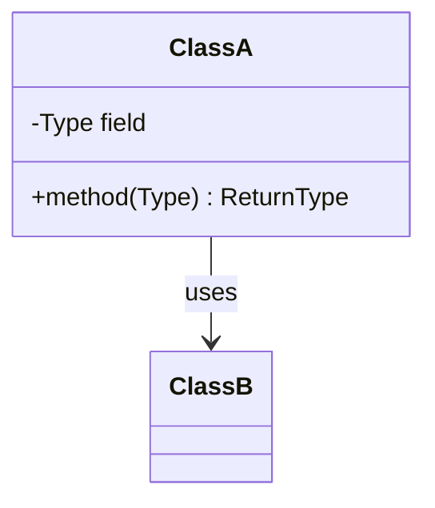

# Design [thing]

> One-line summary of the object or workflow being designed.

## Requirements and assumptions

**Required behavior**
- ...

**Out of scope / assumptions**
- ...

## Core objects

Identify the important entities and responsibilities.

- `ClassA` — responsibility.
- `ClassB` — responsibility.

## Class diagram

## Key flow

Walk one use case through the collaborating objects, step by step.

## Design choices

Explain the abstractions, patterns, and alternatives. State why each pattern earns its place.

## Concurrency and edge cases

Cover races, invalid state transitions, resource limits, and recovery behavior.

## Sources and related reading

Link related material in this repository and cite external references for implementation-specific claims. Identify direct adaptations and their sources.
