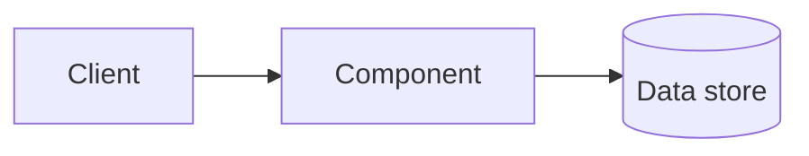

# [Pattern name]

> One-line summary of the problem this pattern solves and its key trade-off.

## What it is

Explain the concept in plain language and how it works.

## When to use it

- Describe the workload or requirement that makes this useful, and what evidence would justify adding it.
- Name a case where it would be a poor fit and the operational cost it adds.

## How it works

Use a short sequence or diagram to explain the mechanism.

## Trade-offs and failure modes

| Benefit | Cost or risk |
|---------|--------------|
| ... | ... |

Include operational failure cases and how to detect them.

## Variations and alternatives

Explain the common alternatives and when to choose each.

## Interview use

What requirements signal this pattern, and what follow-up question tests whether the design is sound?

## Related reading and sources

Link related pages in this repository. Cite primary references for implementation-specific claims, and identify any directly adapted source material.
