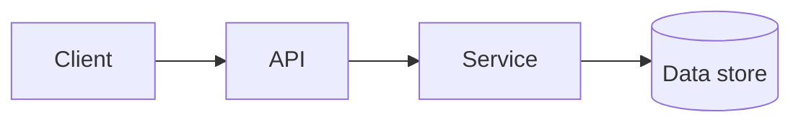

# Design [system]

> One-line summary of the user problem and system being designed.

## Problem and scope

State the main use cases, out-of-scope behavior, and assumptions you need the interviewer to confirm.

## Requirements

**Functional**
- ...

**Non-functional**
- Scale, latency, availability, consistency, durability, and cost expectations.

## Capacity estimate

Show the assumptions and rough math for peak traffic, storage, and bandwidth. Link to the [estimation guide](../cheat-sheets/estimation.md).

## API and data model

List the operations and the entities/access patterns that shape the data model. Call out important invariants.

## High-level design

Draw the main components and their connections. Keep the first version simple, then evolve it as requirements demand.

## Critical flows

Walk through one read path and one write path. Show where synchronous work ends and asynchronous work begins.

## Deep dive

Choose one or two important decisions: partitioning, consistency, fan-out, caching, scheduling, or another system-specific challenge. Explain alternatives and why the selected approach fits.

## Failure modes and recovery

Describe the important failures, how the system detects and contains them, and what guarantees users see during recovery. Include retry and idempotency behavior where relevant.

## Bottlenecks and trade-offs

| Decision | Why it fits | Cost or risk |
|----------|-------------|--------------|
| ... | ... | ... |

Name the first likely bottleneck and how you would measure it before scaling.

## Interview follow-ups

- What requirement change would alter this design?
- What fails first at ten times the traffic?

## Sources and related reading

Link relevant pages in this repository and cite primary sources for implementation-specific facts. If this walkthrough adapts a source, identify it and say what was changed.
